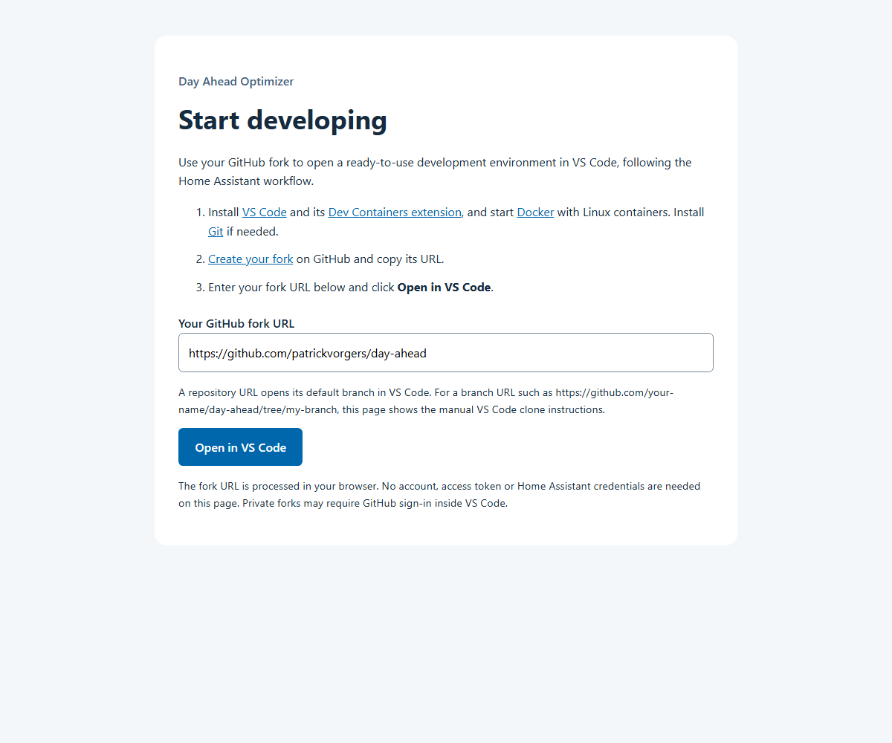

# Developer Guide for Day Ahead Optimizer

This guide will help developers set up their development environment, test changes locally, and contribute to the project.

## Table of Contents

- [VS Code quick start](#vs-code-quick-start-recommended)
- [Your first development session](#your-first-development-session)
- [Start-up troubleshooting](#start-up-troubleshooting)
- [Prerequisites](#prerequisites)
- [Manual development environment setup](#manual-development-environment-setup)
- [Project Structure](#project-structure)
- [Running the Application Locally](#running-the-application-locally)
- [Testing](#testing)
- [Making Contributions](#making-contributions)
- [Code Style and Best Practices](#code-style-and-best-practices)
- [Getting Help](#getting-help)

---

## VS Code quick start (recommended)

A **Dev Container** is a development environment running in Docker on your computer. This repository contains the instructions to build it and automatically install Python, Node, the application and developer tools. VS Code connects to that environment so you can edit, run and debug the application without installing Python or Node on your computer.

Install Git, Docker (Docker Desktop on Windows/macOS) and VS Code with the **Dev Containers** extension. On Windows, enable Docker Desktop's Linux containers/WSL 2 backend. Docker must be running; host Python and Node installations are not needed for this route.

### Start from the developer page

Open the [developer start page](https://corneel27.github.io/day-ahead/developer/) to start from your own fork.

The procedure follows Home Assistant's developer start page:

1. [Fork the repository on GitHub](https://github.com/corneel27/day-ahead/fork) and copy your fork URL. Keep your fork's `main` branch current using GitHub's **Sync fork** action.
2. Paste the URL into the developer page and click **Open in VS Code**.
3. Allow your browser to open VS Code and wait for the automatic clone, container build and installation. Install Dev Containers if VS Code prompts you to do so.
4. Press **F5** to start the web preview. Ruff feedback and the test tools are ready to use.



For a repository URL, the page opens VS Code's **Clone Repository in Container Volume** flow on the default branch. There is no manual clone, interpreter selection or installation command. For a GitHub branch URL (`/tree/branch`), the page shows instructions for using that command directly in VS Code: the browser URI handler does not support branch URLs. Paste the full branch URL into the command to preserve the selected branch. The browser and VS Code can ask for permission to open the application, clone and trust the workspace.

### Direct VS Code alternative

[](https://vscode.dev/redirect?url=vscode%3A%2F%2Fms-vscode-remote.remote-containers%2FcloneInVolume%3Furl%3Dhttps%253A%252F%252Fgithub.com%252Fcorneel27%252Fday-ahead)

1. Fork the repository on GitHub. In VS Code, run **Dev Containers: Clone Repository in Container Volume...**, paste your fork URL and select the branch you want to develop. The Open button above opens `corneel27/day-ahead` directly for exploration. You can also paste a GitHub branch or PR URL into the clone command.
2. Wait for the container build and automatic setup. Python, Node, application/test dependencies, frontend assets, Ruff, hooks and editor extensions are prepared automatically. A new workspace selects its application interpreter automatically; there is no separate install command or environment activation.
3. Press **F5** with **Day Ahead: web preview** selected. The web preview opens in your browser once Flask is ready. Alternatively, choose **Terminal > Run Task > Development: Run Day Ahead** to start without debugging, then open `http://localhost:5000`.
4. For calculation-core work, select **Day Ahead: debug synthetic scenario** and press **F5**. Open **Testing** for isolated unit/regression tests, or run **Tests: Solve all synthetic scenarios** from **Terminal > Run Task** for the solver corpus.

The container-volume route stores the checkout in Docker's Linux filesystem and avoids sharing a Windows virtual environment with Linux. To reopen it later, use **Remote Explorer > Dev Containers**. Push commits to your fork to retain your work independently of the local Docker volume.

**Existing checkout:** open its repository root and choose **Dev Containers: Reopen in Container**. Keep your personal files and settings. Only if an earlier interpreter selection overrides the default, select `.venv/bin/python` with **Python: Select Interpreter**. Ruff normally starts after automatic setup; use **Ruff: Restart Server** if it was already running before tools changed. Allow automatic tasks in this trusted folder when prompted to enable the Ruff version watcher. VS Code may request permission to open links, trust the repository or run automatic tasks; these choices remain with the developer.

The preview uses `.local/web-data` with example options, empty secrets and empty image/log directories. Setup preserves existing preview edits and never copies credentials from `dao/data`. It is an empty web preview, not a simulated production dashboard: reports require a separately configured installation, and live task execution/state endpoints are disabled in preview mode. Use the synthetic scenario debugger for calculation-core work. Synthetic scenarios exercise planning independently of Home Assistant and databases. Existing `dao/data` files are not changed by setup.

After pulling dependency changes, run **Development: Set up environment**. Changes to the container image require **Dev Containers: Rebuild Container**. Setup is repeatable; restart Ruff after tooling changes. Do not reuse a Windows `.venv` inside Linux: use a separate Linux checkout or explicitly recreate that environment. Existing hooks are preserved according to the Ruff setup instructions below.

### Your first development session

The first installation needs internet access and can take several minutes. VS Code reads `.devcontainer/devcontainer.json`, builds the environment from the repository's `Dockerfile` and runs `script/setup` to install and configure the application and tools. The container configuration makes VS Code wait for this setup to finish before connecting the editor, so Python and the pinned Ruff launcher are ready when extensions start. The setup output ends with **Environment ready**. Allow workspace trust and automatic tasks when prompted for this repository.

Confirm that the environment is ready:

1. Press **F5** with **Day Ahead: web preview** selected. The preview should open in your browser. If it does not, open VS Code's **Ports** view and use the browser button for port 5000.
2. Open **Testing** in VS Code. The isolated tests should appear; run a test or use **Terminal > Run Task > Tests: Isolated unit and regression tests**.
3. Open a Python file. Ruff findings appear in the editor and **Problems** view; saving applies safe fixes. Formatting on save is not yet enabled. See [the Ruff setup section](#set-up-automatic-feedback-in-vs-code) for a small verification example.

Before your first commit, set your Git name and email on your computer if they are not already configured:

```bash
git config --global user.name "Your Name"
git config --global user.email "your-email@example.com"
```

Use the email associated with your GitHub account, or its GitHub-provided private email address. Dev Containers normally copies your local Git configuration into the container when it starts. If Git still asks for an identity in an already-open container, run the same two commands in its terminal or rebuild the container. See [VS Code's Git credential guide](https://code.visualstudio.com/remote/advancedcontainers/sharing-git-credentials) for credential helpers and SSH forwarding.

Create a feature branch, make a small change, inspect the diff, run the relevant tests, then commit and push to your fork using **Source Control** or the [contribution commands](#creating-a-pull-request). GitHub may ask you to sign in when pushing; follow the authentication prompt and confirm that `origin` points to your fork with `git remote -v`. Your Git name/email identifies commits; it does not sign you into GitHub. If the commit hook fixes a file, review and stage the correction, then commit again.

To continue later, start Docker and reopen the workspace through **Remote Explorer > Dev Containers**. A **Docker volume** keeps the source files and installed tools when the container stops. Deleting that volume deletes its local contents, including unpushed changes; push your work to your fork before removing it.

### Start-up troubleshooting

| Problem | What to do |
| --- | --- |
| The browser does not open VS Code | Install Dev Containers, allow the browser's application-opening prompt, or use the direct VS Code clone procedure above. Branch URLs show manual clone instructions rather than opening VS Code automatically. |
| Docker is unavailable or container creation fails | Start Docker and check that it is using Linux containers. Read the container build/setup log in VS Code's Dev Containers output and report the first failing step. |
| The selected branch has no development setup | Sync your fork with the repository's current `main` branch. A repository-only URL selects the default branch; use the manual VS Code clone command for a specific branch URL. Check that the selected branch contains `.devcontainer/devcontainer.json`. |
| Setup stops before **Environment ready** | Keep the first error from the setup output. After addressing it, use **Development: Set up environment**; use **Dev Containers: Rebuild Container** if image creation failed. |
| Ruff or tests are unavailable after setup | Check that the Python and Ruff extensions are installed in the container. Select `.venv/bin/python` only if the interpreter is wrong; run **Ruff: Restart Server** for missing lint feedback. |
| Ruff reports a required-version mismatch immediately after installation | An older container may have started the extension's bundled Ruff before setup finished. Wait for **Environment ready**, then run **Ruff: Restart Server**. New containers wait for setup before connecting the editor; use **Dev Containers: Rebuild Container** after updating the container configuration. |
| Port 5000 is already in use on your computer | Use the **Ports** view to choose another forwarded local port and open that address. If another preview is running inside the container, stop it before starting F5 again. |
| A commit or push fails | Read the hook output, configure Git identity if requested, or complete GitHub sign-in. Check that the remote is your fork and review/stage any automatic hook fixes. |

For frontend live reload, start **Development: Frontend live reload**, then add `"VITE_DEV": "1"` to a personal copy of the web debug configuration. Port 5173 is forwarded alongside Flask. The default F5 configuration uses built assets and needs no second server.

**Manual Linux/WSL alternative:** to develop directly on Linux or WSL without a container, follow [Manual development environment setup](#manual-development-environment-setup). The separate Ruff-only setup also supports native Windows.

### Automatic installation verification

The **Development environment** workflow builds the actual Dockerfile, runs the same setup used by the Dev Container from a clean checkout, checks Python dependency integrity and Ruff version, validates scenarios, renders the real web preview with built frontend assets, repeats setup, then runs isolated regression tests and all synthetic scenarios. It runs on pushes, pull requests, and weekly to catch changed base images or dependency resolution even without a code change. Dependency upgrade PRs therefore exercise the complete installation route.

Locally, run **Development: Verify environment** for the smoke checks. CI verifies the installation and application startup; extension installation, actual VS Code interactions, breakpoint stopping and browser appearance still require a manual clean-checkout check.

### Maintaining the developer start page

The static page is maintained in `docs/developer/` in this repository. Its **Developer start page** workflow checks repository/branch URL handling on pull requests and publishes only the HTML, JavaScript and stylesheet; it has no server or extra package dependencies.

GitHub Pages publishes the start page at `https://corneel27.github.io/day-ahead/developer/`. Changes to the page on `main` publish automatically through GitHub Actions. Publication uses the repository variable `DEVELOPER_PAGES_ENABLED=true`; the `github-pages` environment restricts deployments to `main`. To republish without changing files, run **Actions > Developer start page > Run workflow** on `main`.

When changing the start page or installation procedure, open the page in a browser, enter the URL of a fork containing the changes and click **Open in VS Code**. Use a fresh Docker volume and VS Code profile; confirm the first-time prompts, automatic setup, Ruff findings and safe fixes on save, test discovery and F5 startup with a working breakpoint. Record results and any incomplete checks in the pull request. CI's clean-install workflow complements this check but does not exercise the browser-to-VS-Code permission prompt.

## Prerequisites

Choose one application development route:

| Route | Requirements | Support |
| --- | --- | --- |
| Dev Container (recommended) | Git, Docker with Linux containers, VS Code and Dev Containers | Linux application environment; Docker Desktop hosts on Windows/macOS |
| Manual Linux/WSL | Python 3.12+ with venv/pip, Node 22.12+, Git, compiler, pkg-config and MariaDB development libraries | Same setup and checks as the container; Python 3.13 matches the container |
| Ruff only | Git and Python 3.12+ | Windows and Linux tooling are checked in CI; this does not install the application or solver |

Native Windows/macOS application installation is not part of the supported setup. Use the Linux Dev Container on those hosts. macOS Ruff tooling is not covered by the current CI matrix.

## Manual development environment setup

Use this section when running the application directly on Linux or WSL **without the Dev Container**. You install the system requirements and run the repository's setup command yourself.

**Dev Container users can skip this section.** The [recommended VS Code route](#vs-code-quick-start-recommended) builds the container and runs the initial setup automatically. Continue with [Your first development session](#your-first-development-session) after that installation finishes.

### Install and configure on Linux/WSL

Clone your fork and work from the repository root. On Debian/Ubuntu, install the native build prerequisites:

```bash
sudo apt-get update
sudo apt-get install -y build-essential pkg-config libmariadb-dev python3-venv
```

Install Python 3.12+ and Node 22.12+ using your distribution or their supported installation methods; check their versions before continuing. Other Linux distributions need equivalent compiler and MariaDB development packages.

Run the repository's setup and verification commands manually. These are the same scripts used by the automatic container setup:

```bash
python3 scripts/setup_environment.py
.venv/bin/python scripts/verify_environment.py
```

Setup creates the application/test environment in `.venv`, builds frontend assets with `npm ci`, prepares the isolated preview and installs Ruff/hooks in `.venv-tools`. Select `.venv/bin/python` in VS Code. Repeat setup after dependency changes; it preserves existing preview files. Do not share a virtual environment between Windows and Linux checkouts.

For manual Ruff-only installation, use the [Ruff setup instructions](#set-up-automatic-feedback-in-vs-code) below; these do not install the application or solver. For manual application or solver development, use the complete setup above.

### Existing installations and the legacy launcher

`dao/run/run_dev.sh` remains a legacy alternative for an already configured installation. It uses `venv/day_ahead`, prepares files in `dao/data` and starts Vite alongside Flask. Its `--setup` route does not provide the shared developer-tool installation and clean-install verification. New contributors should use the Dev Container or shared Linux/WSL setup above.

Do not mix those environments in one development session. Keep the legacy route for existing workflows until it can be migrated separately.

### Manual installation troubleshooting

If MariaDB Connector/C or mysqlclient cannot build, check the compiler, pkg-config and MariaDB development libraries. Use the pinned `mip` and `cbcbox` from `dao/requirements.txt`; the old manual `mip==1.16rc0` workaround and custom solver-library overrides are obsolete for the supported setup.

Do not remove dependencies or override Python compatibility to force installation. Use the Dev Container and report the failing setup step, operating system and Python/Node versions.

---

## Project Structure

```
day-ahead/
├── dao/                          # Main application directory
│   ├── prog/                     # Core application logic
│   │   ├── day_ahead.py          # Main entry point
│   │   ├── config/               # Configuration loading and models
│   │   ├── scenarios/            # Synthetic calculation scenarios
│   │   ├── da_debug.py           # Scenario command-line tools
│   │   ├── da_scheduler.py       # Optimization scheduler
│   │   ├── da_report.py          # Reporting functionality
│   │   └── utils.py              # Utility functions
│   ├── lib/                      # Database, graphs and data integrations
│   ├── webserver/                # Flask web application
│   │   ├── da_server.py          # Flask server entry point
│   │   ├── gunicorn_config.py    # Production server config
│   │   └── app/                  # Flask application package
│   │       ├── __init__.py       # Flask app initialization
│   │       ├── routes.py         # Web routes/endpoints
│   │       ├── static/           # Static assets (CSS, JS)
│   │       └── templates/        # HTML templates
│   ├── data/                     # Runtime data and configuration
│   ├── tests/                    # Test files
│   └── requirements.txt          # Python dependencies
├── .devcontainer/                # Container build and automatic setup
├── .vscode/                      # Editor settings, tasks and debugging
├── scripts/                      # Environment setup and verification
├── script/setup                  # Shared Linux setup entry point
├── requirements-lint.txt         # Central Ruff version
├── DEVELOP.md                    # Developer instructions
├── setup.py                      # Package setup configuration
└── README.md                     # User documentation
```

---

## Running the Application Locally

This section covers everyday development **after either setup route is complete**. Dev Container users run the application inside the container through VS Code. Developers using the manual Linux/WSL setup run it in their local `.venv`. The recommended F5 launch and testing workflow are available to both routes.

### Running the Flask Web Server

The Day Ahead Optimizer includes a Flask-based web interface for configuration and visualization.

#### Start the isolated preview in VS Code (recommended)

In VS Code, select **Day Ahead: web preview** and press **F5**. This builds assets and starts Flask inside the selected Linux environment. With a Dev Container, the application runs inside that container; with manual Linux/WSL setup, it runs in the local environment. No second application container is started. The development image includes extra tooling and does not replace production-image validation.

#### Manual terminal alternative (native Linux/WSL)

Use these commands if you completed the manual Linux/WSL setup and want to start without the VS Code launch configuration. Run them from the repository root. Dev Container users can use **F5** or **Development: Run Day Ahead** instead; they do not need to repeat this manual start procedure.

```bash
source .venv/bin/activate
export PYTHONPATH="$(pwd):$(pwd)/dao/prog"
export DAO_WEB_DATA_DIR="$(pwd)/.local/web-data"
export MPLBACKEND=Agg
export TZ=UTC
unset VITE_DEV
cd dao/webserver
python -m flask --app app run --host 127.0.0.1 --port 5000
```

For a remote container, F5 binds Flask to all container interfaces and the Dev Container forwards port 5000. If the host port is occupied, select another forwarded local port in VS Code's **Ports** view.

#### Debug one calculation scenario

Select **Day Ahead: debug synthetic scenario** and press **F5**. Enter one scenario ID; the default is `battery-flat-no-incentive`. List available IDs from the repository root:

```bash
PYTHONPATH=.:dao/prog .venv/bin/python -m dao.prog.da_debug scenario-list
```

Set a breakpoint in `dao/prog/scenarios/runner.py` inside `run_scenario`, or in `dao/prog/day_ahead.py` inside `calc_optimum`. The launch runs one synthetic scenario with one solver thread, captures logs and writes a report under `dao/data/scenario_reports`. It needs no Home Assistant or database credentials. Continue execution to inspect the scenario's PASS/FAIL result. It does not update scenario baselines.

Use **Day Ahead: debug test** through the Testing view to debug an individual isolated test. Use **Tests: Solve all synthetic scenarios** for the full solver corpus.

#### Build or serve the assets

If you want to change or update the stylesheets or js dependencies, it is recommended to run 
the Vite server. Mind setting the VITE_DEV env in the step when starting the Python server.

```bash
cd dao/webserver
npm run vite-serve
```

If you just want to work on the Python codebase, you can build the assets:

```bash
cd dao/webserver
npm run build
```

#### Developing on a remote machine

Running the code on a server, NAS or VM and opening the web interface from your
laptop works without extra configuration: the page requests the Vite assets from
the same host you typed in the address bar, and Vite advertises its own address
for anything it generates itself (the icon fonts, for instance).

What you do have to arrange:

- **Port 5173 must be reachable** from your browser. Vite listens on all
  interfaces, but the firewall of the development machine has to allow it.
- **When you use a hostname** instead of an IP address, add it to
  `VITE_DEV_ALLOWED_HOSTS`. Vite rejects unknown `Host` headers to protect against
  DNS rebinding, and only sends the CORS headers that let the page read the assets
  to known origins. IP addresses and `localhost` are always accepted.

  ```bash
  export VITE_DEV_ALLOWED_HOSTS=dao.local
  ```

- **When you tunnel the port over SSH**, the page is served on `localhost` and the
  auto-detected Vite address is the LAN address of the server, which the browser
  may not be able to reach. Pin both sides to `localhost`:

  ```bash
  ssh -L 5000:localhost:5000 -L 5173:localhost:5173 user@dev-machine
  export VITE_DEV_HOST=localhost   # for the Vite server
  ```

If you only work on the Python code, skip the Vite server entirely: build the
assets once and start the webserver without `VITE_DEV`.

```bash
cd dao/webserver
npm run build
unset VITE_DEV
python -m flask --app app run --host 127.0.0.1 --port 5000
```

You lose hot reloading of stylesheets, which does not matter when only touching
Python.

#### Frontend environment variables

| Variable | Used by | Default | Purpose |
| --- | --- | --- | --- |
| `VITE_DEV` | webserver | unset | When `1`, load the assets from the Vite dev server instead of from `app/static/build`. |
| `VITE_DEV_PORT` | webserver, Vite | `5173` | Port of the Vite dev server. |
| `VITE_DEV_SERVER` | webserver | derived from the request | Pin the base URL the browser uses for the assets, for example `http://127.0.0.1:5173` behind a proxy. |
| `VITE_DEV_HOST` | Vite | first non-internal IPv4 | Address Vite advertises in the asset URLs it generates. |
| `VITE_DEV_ALLOWED_HOSTS` | Vite | empty | Comma separated hostnames Vite accepts, both as `Host` header and as the origin allowed to fetch the assets, besides `localhost` and IP addresses. |
| `FLASK_PORT` | webserver | `5000` | Port of the Flask development server. |


### Working with a configured installation

The isolated preview and synthetic scenarios are the default development workflow. Live price/weather APIs, Home Assistant tasks, database operations and populated reports require a separately configured installation.

Use [dao/DOCS.md](dao/DOCS.md) for application settings. Keep live credentials and data outside the disposable preview, select configuration paths deliberately, and use a dedicated test installation for changes that can write to Home Assistant or databases. The legacy `test_dao.py` and EV harness can access live data and are excluded from the isolated test commands below.

## Testing

From the repository root in the container or native Linux/WSL environment:

```bash
.venv/bin/python scripts/develop.py check
.venv/bin/python -m pytest -c pytest-dev.ini -q
PYTHONPATH=.:dao/prog TZ=UTC MPLBACKEND=Agg .venv/bin/python -m dao.prog.da_debug scenario-run --report
```

The pytest selection contains isolated unit/regression tests. Solver cases skipped there are exercised by the separate scenario command. Optional MariaDB cases require a dedicated disposable database and are currently skipped without it. See [docs/testing.md](docs/testing.md) for detailed test scope and results.

### Manual clean-checkout acceptance

Perform this check when changing setup, editor settings or debugger configuration. CI cannot demonstrate actual VS Code interaction or visible breakpoint stops.

- [ ] Open a fresh clone of the change branch with no pre-existing virtual environments in **Dev Containers: Reopen in Container**; allow setup to finish.
- [ ] Confirm that `.venv/bin/python` was selected automatically; select it manually only if needed. Allow the folder-open watcher. Confirm Ruff diagnostics appear in a temporary Python file, then remove the file.
- [ ] Launch **Day Ahead: web preview** with F5, open forwarded port 5000 and check the configuration/chart pages and built frontend assets.
- [ ] Set a Python route breakpoint and refresh the page; confirm the debugger stops, then continue.
- [ ] Launch **Day Ahead: debug synthetic scenario** with the default ID. Confirm a breakpoint inside `run_scenario` or `calc_optimum` stops; inspect variables, continue and confirm one passing scenario/report.
- [ ] Run **Tests: Isolated unit and regression tests**, **Tests: Solve all synthetic scenarios** and **Ruff: Check all Python files**.
- [ ] Repeat **Development: Set up environment** and **Development: Verify environment**. Confirm preview edits are preserved and startup still succeeds.

Record commit SHA, host OS/architecture, Docker/VS Code versions, results and any failure in the PR. An unchecked item is pending manual validation, not evidence of success.

### Required checks before merge

Changes to `main` go through a pull request. The following GitHub Actions checks must pass before merging:

- `Ruff lint`
- `Scenario suite (unit)`
- `Scenario suite (solve)`
- `Developer setup (ubuntu-latest)`
- `Developer setup (windows-latest)`
- `clean-install` (Development environment workflow)

Formatting is not a required merge check. The current checks enforce the shared lint configuration and verify application behavior and developer setup.

When changing branch protection, verify enforcement on a disposable PR branch: add an undefined-name lint violation, confirm `Ruff lint` fails and normal merging is blocked, then remove the violation and confirm all required checks pass. Record any maintainer bypass policy and the verification result; do not merge the violation.

---

## Making Contributions

### Branching Strategy

This project uses the following branching model:

- `main` - Main development
- `feature/*` - Feature branches
- `bugfix/*` - Bug fix branches
- `hotfix/*` - Urgent production fixes

### Creating a Pull Request

1. **Fork the Repository** (if you're an external contributor)

   Click the "Fork" button on GitHub to create your own copy of the repository.

2. **Create a Feature Branch**

   Always create a new branch for your changes:

   ```bash
   git checkout main
   git pull origin main
   git checkout -b feature/your-feature-name
   ```

   Use descriptive branch names:
   - `feature/add-solaredge-integration`
   - `bugfix/fix-price-calculation`
   - `docs/update-installation-guide`

3. **Make Your Changes**

   - Write clear, readable code
   - Follow existing code style and conventions
   - Add comments for complex logic
   - Update documentation if needed

4. **Test Your Changes**

   Run the isolated [testing commands](#testing) from the repository root. Run the manual acceptance checklist when changing the development environment. Use a separately configured test installation for live integration checks.

5. **Commit Your Changes**

   Write clear, descriptive commit messages:

   ```bash
   git add .
   git commit -m "Add feature: integration with SolarEdge API"
   ```

   Good commit message examples:
   - `Fix: Correct battery SoC calculation overflow`
   - `Feature: Add support for PostgreSQL database`
   - `Docs: Update installation instructions for Raspberry Pi`
   - `Refactor: Simplify price calculation logic`

   The title of your commit should finish the sentence: This commit will ...
   Example: 'This commit will ... add support for postgresql database ...'

6. **Push to Your Fork**

   ```bash
   git push origin feature/your-feature-name
   ```

7. **Create the Pull Request**

   - Go to the original repository on GitHub
   - Click "Pull Requests" → "New Pull Request"
   - Select your fork and branch
   - Fill in the PR template:

   **Title:** Clear, concise description (e.g., "Add SolarEdge API integration")

   **Description:**
   ```markdown
   ## Description
   Brief description of what this PR does and why.

   ## Changes Made
   - List key changes
   - Include any breaking changes
   - Note any new dependencies

   ## Testing
   - Describe how you tested these changes
   - List any test cases added

   ## Related Issues
   Closes #123
   ```

8. **Respond to Review Feedback**

   - Address reviewer comments
   - Make requested changes in new commits
   - Push updates to the same branch (they'll appear in the PR automatically)

9. **Keep Your Branch Updated**

   If the main branch changes while your PR is open:

   ```bash
   git checkout main
   git pull origin main
   git checkout feature/your-feature-name
   git rebase main
   git push --force-with-lease
   ```

### Pull Request Checklist

Before submitting your PR, ensure:

- [ ] Code follows project conventions
- [ ] All tests pass
- [ ] New features include tests
- [ ] Documentation is updated
- [ ] Commit messages are clear
- [ ] No unnecessary files are included (check `.gitignore`)
- [ ] Changes are based on the latest `main` branch

---

## Code Style and Best Practices

### Python lint checks

#### Set up automatic feedback in VS Code

The Dev Container and the shared application setup already install these tools. The manual procedure below is for Ruff-only work or an existing environment that has not used that setup.

Open the repository root in VS Code and install the recommended **Python** and **Ruff** extensions from the Extensions view (`@recommended`). Select an installed Python 3.12 or newer with **Python: Select Interpreter**, then choose **Terminal > Run Task > Development: Set up Ruff**. If Ruff was already running before setup, run **Ruff: Restart Server** from the Command Palette. A fresh Dev Container starts Ruff automatically after setup. In a remote workspace, install the extensions in that workspace's extension host.

The same setup works for a new checkout or an existing development environment. It creates a dedicated `.venv-tools` directory, installs `requirements-dev.txt`, prepares and installs the commit hook, and runs the full lint check. It can be rerun after pulling tool upgrades. It leaves the application environment and selected application interpreter intact. Internet access is required for the initial tool and hook installation; subsequent checks use the installed tools.

Without VS Code, run the same procedure from the repository root:

```bash
python scripts/develop.py setup
```

Use `python3` on systems where `python` is unavailable, or `py -3.13` on Windows when that is your installed interpreter. Setup reads the minimum version from `ruff.toml` rather than requiring a particular launcher. On Debian, install the matching `python3-venv` package if virtual-environment creation is unavailable.

While editing, Ruff reports lint findings in the editor and Problems view. Saving a Python file explicitly, or using Auto Save on focus/window change, applies Ruff's safe fixes and import organization. Findings such as undefined names still require a manual fix. Review automatic changes and run tests for affected behavior before committing. VS Code skips these save actions for timed Auto Save (`afterDelay`); use Save or select `onFocusChange`/`onWindowChange` if you want automatic fixes. Live lint feedback remains available while typing. Formatting on save is disabled; explicit **Format Document** remains available through Ruff.

VS Code uses a version-checked Ruff launcher from `.venv-tools`, independently of the application interpreter. Both Windows and Unix executable paths are included. The filesystem configuration takes precedence over editor rule settings. `requirements-lint.txt` is the single maintained Ruff version pin. Setup and version checks derive an ignored `.ruff.toml` that extends the shared `ruff.toml` and enforces that version, including when the extension falls back to another Ruff executable. Do not edit the generated file. An existing personal `.ruff.toml` is preserved: resolve that configuration conflict before enabling this setup.

When opening the repository, allow **automatic tasks in this trusted folder** when VS Code asks, or use **Tasks: Manage Automatic Tasks in Folder**. **Development: Watch Ruff version** checks the installation immediately and continues watching the requirements pin and installed executable. Its dedicated terminal reports missing or stale tools with the commands needed to repair them. The same warning appears in **Problems** under **Ruff setup** and is cleared when the installation matches again. Ruff tasks use `python3` on Linux and `py -3` on Windows, requiring Python 3.12+; the Dev Container supplies it automatically. They do not depend on the Python extension activating before folder-open tasks run. Application and test tasks use the checkout's `.venv/bin/python`. The task can also be started manually; without permission for automatic tasks, it does not start on its own.

After a pull changes the Ruff pin, the watcher updates the generated version guard and reports the mismatch within its two-second polling interval. The editor launcher also stops an already-running Ruff server when the required version changes. Local lint tasks and all commits, including commits without Python changes, stop until the installed version matches. Nothing is installed automatically. Run **Development: Set up Ruff**, followed by **Ruff: Restart Server**; the watcher reports readiness once the environment is current. Inspect **Output > Ruff** for editor server failures or the launcher path. Before the first successful setup or workspace check, the extension may still use its normal executable fallback; install the tools before relying on its feedback.

The following tasks are available through **Terminal > Run Task**:

| Task | Result |
| --- | --- |
| Development: Set up Ruff | Install or refresh tools and activate the commit hook |
| Development: Watch Ruff version | Check at workspace opening and report version changes during the session |
| Development: Check Ruff version | Check the installation once and show repair instructions if needed |
| Ruff: Check all Python files | Check the complete repository using the same configuration as CI |
| Ruff: Apply safe fixes to all Python files | Apply safe lint fixes; review the diff afterwards |
| Ruff: Run commit hooks on all files | Run the fixing hook across tracked Python files |

The commit hook checks staged Python files, including tracked tests despite the legacy `.gitignore`. If it fixes a file, the commit stops: inspect the diff, stage the corrected file and commit again. Remaining findings also block the commit. CI checks the complete repository, including files not touched by the commit.

For an existing checkout, keep any personal workspace settings and merge the Ruff entries if necessary. Disable competing Python fix-on-save actions if they cause conflicting edits. Setup uses pre-commit's migration mode to preserve existing custom hooks; it does not use `--overwrite`. If `core.hooksPath` is configured, setup stops with an explanation instead of changing it. Integrate pre-commit with that hook manager, or run local checks manually. Use `pre-commit uninstall` through the tool environment to restore a migrated hook.

To verify the editor installation, create a temporary Python file containing `import os` and `print(missing_name)`. Ruff should show `F401` and `F821`; saving removes the unused import and leaves the undefined name visible. Fix the name, delete the temporary file and run **Ruff: Check all Python files**. This checks the same rules that CI uses, with editor fixes occurring earlier.

#### Set up Ruff in PyCharm

PyCharm users can keep their existing application interpreter and development environment. VS Code and Docker are optional. The setup below installs only the shared developer tools; new native Linux application checkouts still need the [manual application setup](#manual-development-environment-setup).

1. **Install the shared tools.** Open the repository root in PyCharm and use its terminal with Python 3.12 or newer. If the shared application setup has already installed the tools, start with `status` instead of repeating `setup`:

   ```bash
   python3 scripts/develop.py setup
   python3 scripts/develop.py status
   ```

   Setup creates `.venv-tools`, installs the pinned Ruff and commit hooks, and leaves the application environment intact. On Windows, use an installed Python 3.12+ launcher as described above; this provides Ruff tooling, not a native Windows application setup.

2. **Choose the Ruff integration.** In current PyCharm, open **Settings > Python > Tools > External Tools** and enable Ruff. If your version has no built-in Ruff integration, follow the plugin instructions in [Ruff's PyCharm setup guide](https://docs.astral.sh/ruff/editors/setup/#pycharm). Use one Ruff integration at a time. Menu names and available features depend on the PyCharm version; see [JetBrains' Python tools documentation](https://www.jetbrains.com/help/pycharm/lsp-tools.html).

3. **Select the project launcher explicitly.** Use the Ruff executable's Path option and point it to the absolute path of `.venv-tools/ruff-project` in this checkout, for example `/home/your-user/day-ahead/.venv-tools/ruff-project`. Windows uses `.venv-tools/ruff-project.exe`. Where invocation sources are configurable, disable SDK, PATH auto-detection and `uvx` fallbacks so another Ruff version cannot be selected. Keep the application's Python interpreter selected; do not replace it with `.venv-tools`.

   Let Ruff discover the project configuration. Setup generates `.ruff.toml`, which extends `ruff.toml` and adds the required-version guard. If the IDE requires an explicit configuration path, select that generated `.ruff.toml`; do not edit it or duplicate rule selections in PyCharm settings.

4. **Enable feedback.** Enable Ruff inspections and available quick fixes. Until repository-wide formatter adoption is complete, leave automatic Ruff formatting disabled. Apply safe quick fixes and review their changes. Fix-on-save options depend on the integration and version; verify them separately if you enable them rather than assuming they match the VS Code save actions.

5. **Verify the integration.** Create a temporary `ruff_probe.py` in the repository root, outside excluded directories such as `.local`:

   ```python
   import os

   print(missing_name)
   ```

   Ruff should report `F401` and `F821`. Confirm that they are Ruff diagnostics, rather than only PyCharm's own inspections. Apply the unused-import quick fix: `F401` should disappear while `F821` remains. Change the print statement to `print("Ruff works")`; the remaining finding should clear. Delete the temporary file and run:

   ```bash
   python3 scripts/develop.py check
   ```

During normal development, use PyCharm to edit, run and debug as before. The installed pre-commit hooks check changes made from either the terminal or the IDE. If a hook applies fixes, inspect the diff, stage the corrected files and commit again. CI checks the complete repository using the same shared Ruff version and configuration.

After pulling a change to the Ruff requirement, rerun `python3 scripts/develop.py setup` and `python3 scripts/develop.py status`. Restart the Ruff integration or reopen the project if its server was already running. The project launcher rejects a version mismatch and stops an outdated running server; it does not install upgrades automatically. For continuous terminal monitoring, `python3 scripts/develop.py watch` reports missing or stale tools; stop it with Ctrl+C. Unlike the VS Code folder-open task, this watcher does not start automatically in PyCharm.

The shared tooling and hooks are verified on Linux and Windows. PyCharm editor behavior must be confirmed with the verification step above on the installed IDE version; the repository does not currently configure PyCharm automatically or provide automated PyCharm UI acceptance tests.

#### Run lint without editor integration

From the repository root, install the pinned development-only linter and run:

```bash
python -m pip install -r requirements-lint.txt
python scripts/develop.py ci-check
```

`ruff.toml` explicitly enables syntax/import checks, Pyflakes, import ordering,
Python upgrades and Bugbear (`E4`, `E7`, `E9`, `F`, `I`, `UP`, `B`). It targets
Python 3.12 and includes the tracked tests despite the legacy `.gitignore`.
The **Ruff lint** GitHub Actions job runs independently of the solver stack on
every push and pull request. It reports failures rather than modifying code.

To apply safe fixes locally, use `ruff check --fix .`, inspect the diff, then
rerun relevant tests. Do not use `--unsafe-fixes` for routine cleanup. Intentional
startup imports need a narrow suppression with an explanation; do not suppress
whole files or rule families to make the check pass. `zip(..., strict=False)`
preserves existing truncation; use `strict=True` when equal lengths are validated.

Dependabot checks Ruff and pre-commit in the repository root weekly. A Ruff upgrade changes only the pin in `requirements-lint.txt`; the editor, local hook and CI derive their required version from it. Review release notes, changes to standard defaults and new diagnostics, then run lint, formatting once adopted, and relevant behavioral tests before merging the upgrade. Rerun developer setup after pulling a tooling update and restart the editor's Ruff server. Ruff is not an add-on runtime dependency.
Full-repository `ruff format` enforcement is not enabled. See the
[Ruff adoption roadmap](docs/ruff-rollout.md) for the remaining formatting and rule-adoption work.

For behavioral verification on Linux, follow [`docs/testing.md`](docs/testing.md).
The scenario workflow also runs isolated configuration-model, SQLite query,
charging-schedule, KNMI-default and web route regression tests. Optional MariaDB
cases skip unless a dedicated disposable test database is configured. The legacy
`test_dao.py` and EV harness can access a live installation and are not part of
this isolated CI command.

### Python Style Guide

- Follow [PEP 8](https://pep8.org/) style guidelines
- Use 4 spaces for indentation (no tabs)
- Maximum line length: 100-120 characters
- Use meaningful variable and function names

### Code Organization

- Keep functions small and focused (single responsibility)
- Add docstrings to modules, classes, and functions
- Use type hints where appropriate
- Handle exceptions gracefully

### Example:

```python
def calculate_battery_soc(
    current_soc: float,
    charge_power: float,
    duration: float,
    battery_capacity: float
) -> float:
    """
    Calculate the State of Charge (SoC) of the battery after charging/discharging.
    
    Args:
        current_soc: Current state of charge (0.0 - 1.0)
        charge_power: Charging power in kW (negative for discharging)
        duration: Duration in hours
        battery_capacity: Total battery capacity in kWh
    
    Returns:
        New state of charge (0.0 - 1.0)
    
    Raises:
        ValueError: If inputs are out of valid range
    """
    if not 0 <= current_soc <= 1:
        raise ValueError(f"Invalid SoC: {current_soc}")
    
    energy_change = charge_power * duration
    new_soc = current_soc + (energy_change / battery_capacity)
    
    return max(0.0, min(1.0, new_soc))
```

### Logging

Use the logging module instead of print statements:

```python
import logging

logger = logging.getLogger(__name__)

# Use appropriate log levels
logger.debug("Detailed diagnostic information")
logger.info("General information")
logger.warning("Warning message")
logger.error("Error occurred")
logger.exception("Exception with traceback")
```

### Configuration

- Never commit sensitive data (API keys, passwords, etc.)
- Use configuration files (JSON) for settings
- Keep example configurations in the repository
- Document all configuration options

---

## Getting Help

If you need assistance:

- Check existing [Issues](https://github.com/corneel27/day-ahead/issues) on GitHub
- Review the [DOCS.md](dao/DOCS.md) for user documentation
- Create a new issue with:
  - Clear description of the problem
  - Steps to reproduce
  - Expected vs actual behavior
  - Your environment details (OS, Python version, etc.)

---

## License

This project is licensed under the Apache License 2.0. See [LICENSE.txt](LICENSE.txt) for details.

---

## Acknowledgments

Thank you for contributing to the Day Ahead Optimizer project! Your contributions help improve energy optimization for all users.
